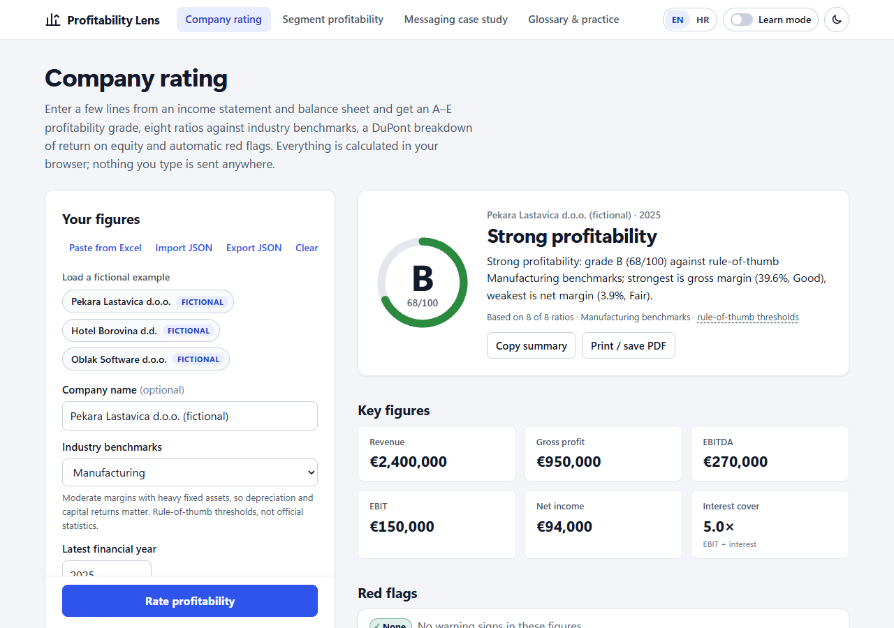
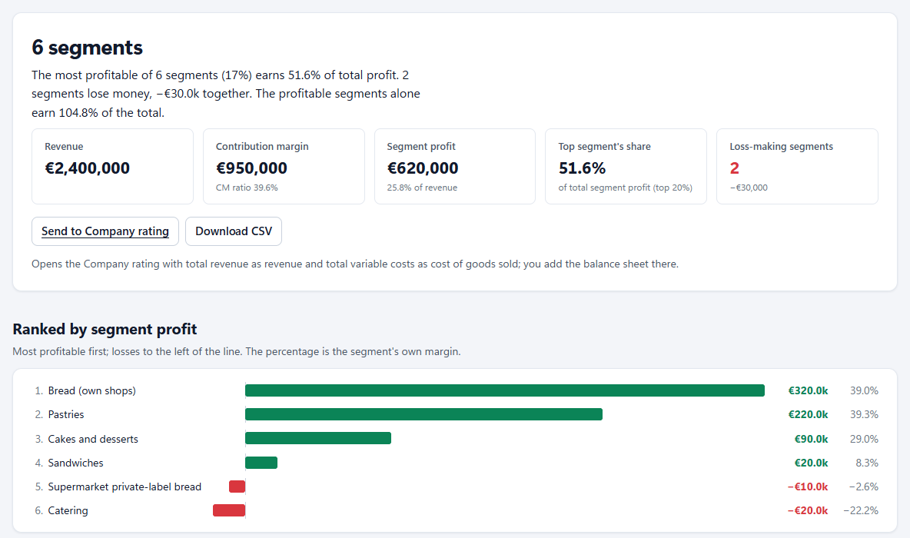
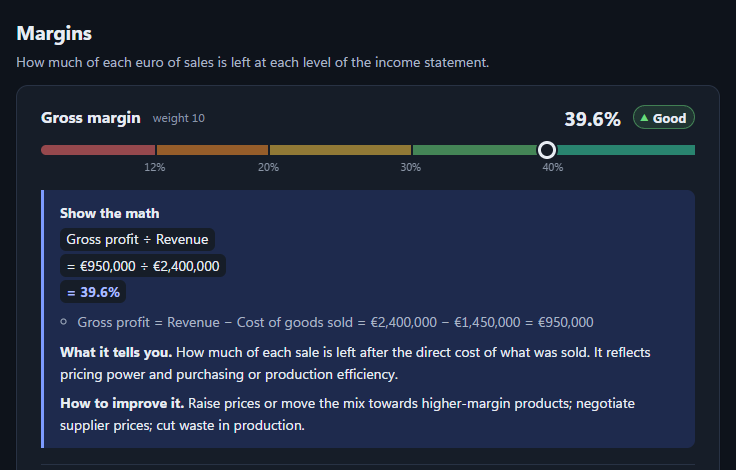
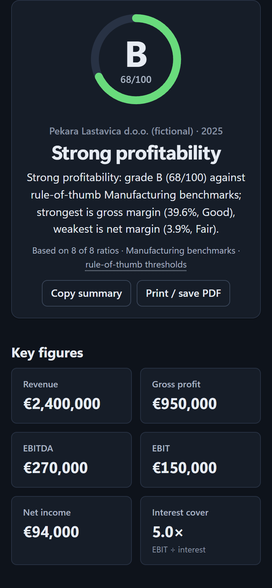

# Profitability Lens

**A free, open-source tool that rates a company's profitability from a few lines of its financial statements, and shows where a business makes and loses money. It runs entirely in your browser, in English and Croatian.**

### ▶ [Open Profitability Lens](https://jangrgur-cmd.github.io/profitability-lens/)

No account, no server, no API keys. Nothing you type leaves your browser. Example companies are fictional, and the industry benchmarks are rule-of-thumb thresholds, not official statistics.



### 60-second tour

1. [**Rate a company:**](https://jangrgur-cmd.github.io/profitability-lens/) load the fictional bakery and press *Rate profitability*. You get an A–E grade, eight ratios against industry benchmarks, a DuPont breakdown of ROE and red flags.
2. [**A 4 % net margin that earns an A:**](https://jangrgur-cmd.github.io/profitability-lens/index.html#case=supermarket) a fictional supermarket whose assets turn fast. A ratio means nothing without its industry.
3. [**Find the loss-making products:**](https://jangrgur-cmd.github.io/profitability-lens/segments.html) the same bakery split into six product lines. Two of them lose money, and the best one earns more than half the profit.
4. [**Which routes lose money:**](https://jangrgur-cmd.github.io/profitability-lens/modules/messaging/#tab=routes) a case study of a business-messaging provider across five countries and four channels.
5. [**Guess the grade:**](https://jangrgur-cmd.github.io/profitability-lens/learn.html) five fictional companies to practise on, a glossary of 54 terms and a [one-page formula cheat sheet](https://jangrgur-cmd.github.io/profitability-lens/cheatsheet.html).

## Why I built it

Profitability analysis is mostly a handful of ratios read together: margins, returns, and how leverage lifts return on equity. The ratios are easy to compute but hard to interpret without a benchmark, and most free tools either stop at the numbers or ask you to upload your figures to someone's server.

This project does the whole loop in the browser. It works out the ratios, compares each with a benchmark for the industry, turns them into one grade and explains in plain words what drives it. It is also a learning tool for students, small business owners and junior analysts: Learn mode shows the math behind every number with your own figures.

## What it does

### Company rating ([index.html](index.html))

- **Inputs:** revenue, cost of goods sold, operating expenses, depreciation, other financial income, interest and tax; total assets, equity, current liabilities, debt and cash; optionally the prior year. Type them in English or Croatian number format (`1,234.56` or `1.234,56`), or **paste them from Excel**. Statement lines are recognised in English and in Croatian GFI-POD wording, including costs by nature.
- **Grade:** A–E with a 0–100 score, **eight ratios** (gross, EBITDA, operating and net margin, ROA, ROE, ROCE, ROIC), each with its value, a benchmark band and a track showing where it sits between the thresholds for seven industries.
- **DuPont breakdown** of ROE into net margin × asset turnover × equity multiplier.
- **Red flags:** net loss, negative equity, operating loss, low interest cover, ROE inflated by leverage, heavy depreciation, thin data.
- **How to reach the next grade:** the smallest change in prices, volume, unit costs or overheads that lifts the grade, and where the score's points are lost.
- **Up to five years** with year-on-year changes and sparklines; **what-if levers** (volume, prices, unit costs, overheads) that re-rate the company live; **comparison with up to three peers**.
- Three fictional examples, JSON export and import, a text summary to copy, and a print stylesheet for PDF.

### Segment profitability ([segments.html](segments.html))

Type or paste a table of customers, products, channels or regions with their revenue and costs. You get each segment's contribution margin and profit, a ranked profit chart, the **whale curve** and the share of profit earned by the top 20 %. "Send to Company rating" carries the totals into the rating.

### Messaging case study ([modules/messaging/](modules/messaging/))

A worked segment analysis of a fictional business-messaging (CPaaS) provider: revenue and margin by country, channel and customer, a route heatmap, scenarios for operator price rises, exchange rates and SMS-to-WhatsApp migration, and all 209 assumptions with their sources. It was a [separate project](modules/messaging/README.md) that joined this one with its git history.



### Learn mode, glossary and practice

Learn mode (switch in the header) adds "Show the math" to every ratio (formula → your numbers → result), what each ratio tells you and how to improve it, field help, a plain-language DuPont sentence, and how segment margins add up to the company margin. The [Glossary & practice](learn.html) page has "Guess the grade" with five fictional companies and a searchable glossary in both languages. The [cheat sheet](cheatsheet.html) prints on one A4 page.

<p>
  
  
</p>

## Method in short

The full method, with a worked example, is in [docs/methodology.md](docs/methodology.md).

| Ratio | Formula | Weight |
|---|---|---|
| Gross margin | Gross profit ÷ Revenue | 10 |
| EBITDA margin | EBITDA ÷ Revenue | 10 |
| Operating margin | EBIT ÷ Revenue | 15 |
| Net margin | Net income ÷ Revenue | 15 |
| ROA | Net income ÷ Average total assets | 15 |
| ROE | Net income ÷ Average equity | 15 |
| ROCE | EBIT ÷ (Total assets − Current liabilities) | 10 |
| ROIC | NOPAT ÷ (Debt + Equity − Cash) | 10 |

1. Each industry has four thresholds per ratio (*poor*, *fair*, *good*, *excellent*). A ratio scores 20 at *poor*, 50 at *fair*, 75 at *good* and 100 at *excellent*, in straight lines between them, and 0 at an equal step below *poor*.
2. The overall score is the weighted average of the ratios that can be calculated. A ratio is never faked: if an input is blank it is **missing**, and if the value has no meaning (ROE on negative equity) it is **not meaningful**. Either way it is left out and the remaining weights are renormalised. The page says how many ratios the grade rests on.
3. Grade: **A** ≥ 80, **B** ≥ 65, **C** ≥ 50, **D** ≥ 35, **E** below 35.

Where textbooks differ (ROE on negative equity, the tax rate in NOPAT, averages or year-end capital), the choice and the reason are in [docs/methodology.md](docs/methodology.md) §7.

## Assumptions and limitations

- **The benchmarks are rule-of-thumb starting points**, set by judgement for seven industries and labelled as such in the interface. They are not calibrated against published sector data yet. That is the first item on the roadmap, with source and year recorded for each value.
- **Eight ratios do not make a credit analysis.** The rating looks at profitability only: no liquidity, cash flow, growth or valuation. One year's statement can hide seasonality and one-off items.
- **Costs by nature:** Croatian statements often have no cost of goods sold. Then gross margin is missing and all costs count as operating expenses, so the grade rests on seven ratios.
- **The segment page does not allocate company-wide overheads.** Segment profit is contribution margin less the segment's own fixed costs. That is deliberate: an arbitrary allocation key can make a segment that covers its own costs look loss-making.
- **The messaging case study** uses public prices and fees where they exist, and estimates for everything else (operator costs, discounts, volumes). Its customers are illustrative archetypes. Each of its 209 assumptions has a status and a source in [docs/assumptions.md](docs/assumptions.md).
- **Croatian terminology** follows GFI-POD forms and Croatian financial-analysis textbooks. The full list, with the less certain terms marked, is in [docs/terminology.md](docs/terminology.md).
- Light and dark colours use CSS `light-dark()`, which needs a browser from 2024 or later.

## How I built it with Claude Code

I built Profitability Lens with Claude Code, Anthropic's AI coding assistant. I decided what to build and the rules it had to follow. Claude Code wrote the code, the tests and most of the documentation, one phase at a time. Each phase ended with a check in the browser and a commit.

- **A written brief.** [`CLAUDE.md`](CLAUDE.md) holds the project's constraints (free, static, no data leaving the browser, no AI calls at run time), the rating method with a hand-checkable test case, the architecture and a six-phase plan. Claude Code reads it at the start of every session, so the rules do not drift between sessions.
- **A decision log.** Every non-trivial choice is in [`DECISIONS.md`](DECISIONS.md) with the date, who made it and why. Where Claude made a judgement call (the benchmark thresholds, Croatian terms, how the what-if levers treat tax), it is marked for my review rather than presented as settled.
- **Tests before refactoring.** Before any shared code was moved out of the messaging dashboard, golden tests locked every number it shows. The refactor had to keep them green without regenerating the expected values.
- **Pure, tested calculations.** Every formula lives once, in modules with no DOM code, and runs under `node --test`: parsing, formatting, ratios, the rating, multi-year chaining, what-if, segments, the practice cases, and a check that every English text has a Croatian twin with the same placeholders.
- **Checked in the browser.** At the end of each phase the pages were checked at desktop and phone width, in light and dark mode and in both languages. One sweep clicked through every filter and flow and found the bugs fixed in [0.5.0](CHANGELOG.md).

The changes, phase by phase, are in the [CHANGELOG](CHANGELOG.md).

## Run locally

From the project folder, start any static web server and open the address it prints:

```
npx serve .
```

or

```
python -m http.server
```

| Command | What it does |
|---|---|
| `node --test` | all tests (the site and the messaging module) |
| `node modules/messaging/scripts/generate-data.mjs` | regenerates the messaging traffic data after editing its assumptions |
| `node scripts/build-assumptions-doc.mjs` | regenerates `docs/assumptions.md` |
| `node scripts/screenshots.mjs` | retakes the README screenshots with a local Edge or Chrome |

Plain HTML, CSS and JavaScript modules: no framework, no build step and no npm packages. [Chart.js](https://www.chartjs.org/) is included in `modules/messaging/lib/`. GitHub Actions runs the tests on every push and pull request and publishes the site to GitHub Pages from `main`.

### Project layout

```
index.html, segments.html, learn.html, cheatsheet.html    the pages
src/shared/      parsing, formatting, margins, languages (lang/en.js, hr.js), header, theme
src/rating/      the rating engine (fields, ratios, benchmarks, rating) and its page
src/segments/    the general segment module
src/learn/       practice cases, quiz, glossary, cheat sheet
modules/messaging/   the messaging case study
tests/           node --test unit tests
docs/            methodology, assumptions, terminology, screenshots
```

## Contributing

Bug reports, ideas, sector data to calibrate the benchmarks and fixes to the Croatian terminology are welcome. The [issue templates](.github/ISSUE_TEMPLATE/) ask for what is needed. Please never paste a real company's confidential figures into an issue.

## Licence

[MIT](LICENSE)

## Author

Jan Grgur Glivar · [LinkedIn](https://linkedin.com/in/jangrgurglivar)

Entrepreneurial Economics student, VERN' University, Zagreb.
