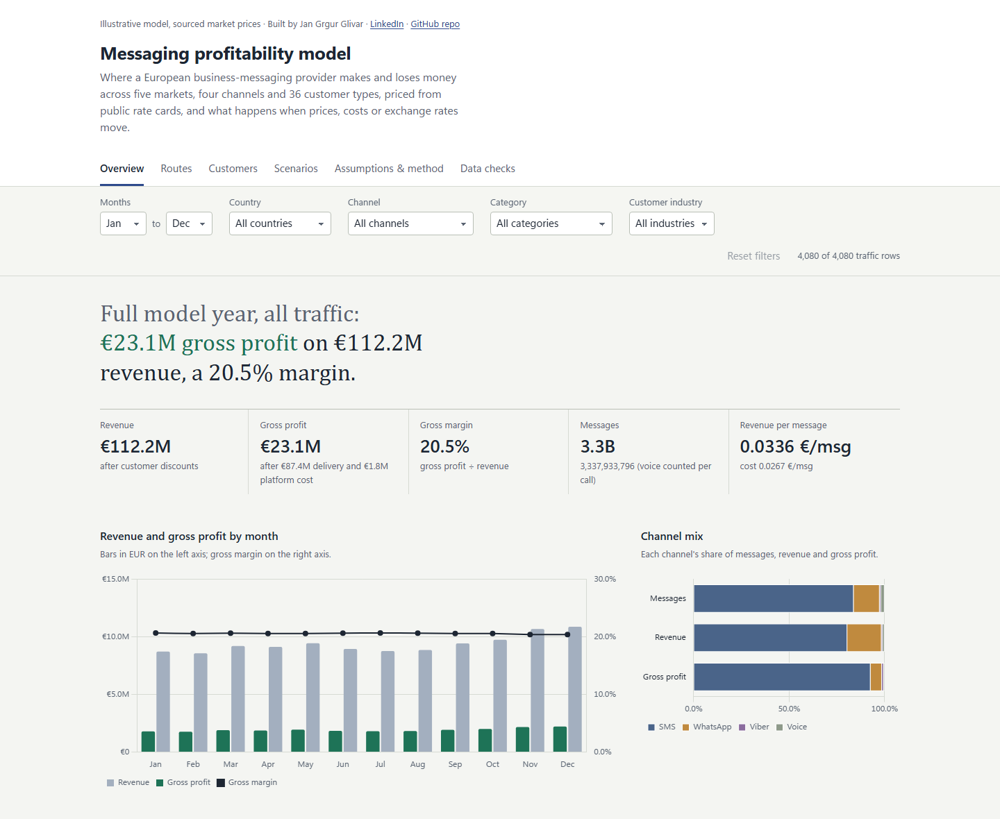
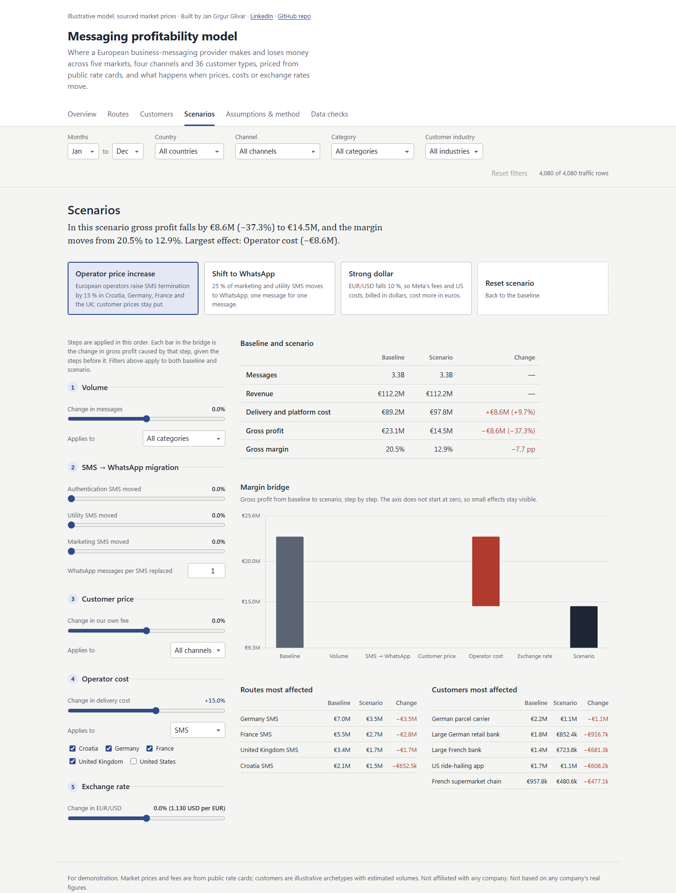

# Messaging profitability model

**An interactive dashboard that shows where a European business-messaging provider makes and loses money, by country, channel and customer, and what happens to its margin when operator prices, exchange rates, customer prices or channel mix change.**

### ▶ [Open the live dashboard](https://jangrgur-cmd.github.io/messaging-profitability/)

Runs entirely in the browser. Market prices come from public rate cards; customers are illustrative archetypes.

### 60-second tour

1. [**The headline:**](https://jangrgur-cmd.github.io/messaging-profitability/) revenue, gross profit and margin for the whole model year, with monthly trend and channel mix.
2. [**Which routes lose money:**](https://jangrgur-cmd.github.io/messaging-profitability/#tab=routes) margin for every country × channel, and how much delivery cost each route can absorb before it breaks even.
3. [**A 15% operator price increase in Europe:**](https://jangrgur-cmd.github.io/messaging-profitability/#tab=scenarios&sc=15&scc=SMS&sco=HR%2CDE%2CFR%2CGB) the margin bridge shows where the profit goes.
4. [**A 10% stronger dollar:**](https://jangrgur-cmd.github.io/messaging-profitability/#tab=scenarios&fx=-10) what happens when fees billed in USD cost more in euros.
5. [**Where every number comes from:**](https://jangrgur-cmd.github.io/messaging-profitability/#tab=assumptions) each assumption with its status and public source.





## The business question

A CPaaS (communications platform as a service) company sells SMS, WhatsApp, Viber and voice messages to businesses: one-time passcodes for banks, delivery updates for couriers, offers for retailers. It does not own the networks. For every message it pays someone else: a mobile operator for SMS and voice, Meta for WhatsApp, Viber for Viber. Its gross margin is the thin gap between what customers pay and those delivery costs.

That makes profitability sensitive to things outside the company's control: operators raising termination rates, Meta changing its rate card, the dollar strengthening against the euro, and customers moving traffic from SMS to WhatsApp. This project models those effects for five markets (Croatia, Germany, France, the United Kingdom and the United States).

I built it while applying for Infobip's Business Analytics (Profitability Management) and Business Internship (Product, Marketing & Telecom Partnerships) programs, to work through the kind of questions those teams answer. It is not affiliated with Infobip and uses none of its data.

## What you can do with it

- **See where the money is made:** revenue, gross profit and margin by month, country, channel, customer and message category, with a filter bar that applies to every view.
- **Find what loses money:** a country × channel margin heatmap with loss-making routes flagged, each route's cost headroom (how far delivery cost can rise before it breaks even), a ranked customer table and a whale curve showing how concentrated profit is.
- **Run what-if scenarios:** change operator costs, the EUR/USD rate, customer prices, volumes or the share of SMS moving to WhatsApp, and read the result in a margin bridge that attributes the change to each step. Three presets are included.
- **Check every input:** each of the 209 assumptions is listed with its value, status (sourced or estimated) and a link to its public source, next to plain-English explanations of every formula.
- **Trust the numbers:** automatic data checks (totals reconcile, no negative values, every row matches its assumptions, the default scenario equals the baseline), CSV export of every table, and shareable links that reproduce any view.

## Key findings

1. **WhatsApp brings revenue, not profit.** It is 18% of revenue but only 6% of gross profit: a 6.8% margin against 23.7% for SMS, because Meta's fee is passed on at cost and the provider keeps about €0.003 per message (SMS: about €0.008). Moving 25% of marketing and utility SMS to WhatsApp barely changes revenue (−€0.7M) but cuts gross profit by €2.4M (−10%).
2. **Operator termination costs decide the margin.** SMS is 93% of gross profit, and every 1% rise in European SMS termination costs about €0.57M a year. A 15% rise in Croatia, Germany, France and the UK cuts gross profit by €8.6M (−37%); SMS prices would have to rise by about 10% to absorb it.
3. **A third of the cost base is in dollars, while prices are in euros.** A 10% stronger dollar cuts gross profit by €3.2M (−14%). WhatsApp is the most exposed: a fall of about 7% in EUR/USD wipes out its whole margin, and German WhatsApp swings from +€0.4M to −€0.6M.

These figures rest on public prices and fees, but also on estimated termination costs, discounts and volumes; the [Assumptions & method](https://jangrgur-cmd.github.io/messaging-profitability/#tab=assumptions) tab shows which is which.

## Method & assumptions

- **Prices and fees are sourced** where public figures exist: WhatsApp fees from Meta's published rate card, SMS and voice list prices and US carrier fees from a large CPaaS provider's public price pages, and the 2025 average EUR/USD rate from ECB reference rates. Each sourced value links to the page it was read from.
- **Everything else is estimated and says why:** operator termination costs (not public), volume discounts, platform cost, channel and category mix, and each customer archetype's monthly volume (users × messages per user × share routed to the provider). Estimated costs and discounts are calibrated so the blended gross margin falls in a range taken from listed peers' reported gross margins.
- **Discounts never apply to pass-through fees:** Meta's WhatsApp fee and US carrier fees are charged on at cost, as providers do in practice.
- Public prices and fees were last checked on 23–24 November 2026; Meta updates its rate card every quarter.
- The full list, the formulas and the scenario order of operations are on the dashboard's **Assumptions & method** tab. The analysis is written up in [`docs/memo.md`](docs/memo.md).

## How it was built

Built with AI assistance (Claude Code). I defined the business questions, chose the markets, scenarios and level of realism, and directed the changes; AI wrote most of the code, researched the public prices and drafted the findings and memo. Every non-trivial choice, and who made it, is in [`DECISIONS.md`](DECISIONS.md).

Plain HTML, CSS and JavaScript with no build step; [Chart.js](https://www.chartjs.org/) for charts. Traffic data is generated by a deterministic script (`scripts/generate-data.mjs`) from `data/assumptions.json`, and all calculations live in pure, unit-tested functions (`js/calc.js`, `js/scenarios.js`).

## Limitations

- Customers are illustrative archetypes, and their volumes are estimates, not real company data.
- Operator termination costs are not public and are estimated as a share of public list prices.
- The cost model is simplified: one list price per country, channel and category; one discount per customer; UK costs in euros; no long-message segmentation, minimum commitments or rebates.
- No fraud or traffic-inflation (artificially inflated traffic) modelling yet.

## Run locally

From the project folder, start any static web server and open the address it prints:

```
npx serve .
```

or

```
python -m http.server
```

Run the tests with `node --test tests/`. Regenerate the traffic data after editing assumptions with `node scripts/generate-data.mjs`.

## Disclaimer

For demonstration. Market prices and fees are from public rate cards; customers are illustrative archetypes with estimated volumes. Not affiliated with any company. Not based on any company's real figures.

## Author

Jan Grgur Glivar · [LinkedIn](https://linkedin.com/in/jangrgurglivar)

Entrepreneurial Economics student, VERN' University, Zagreb.
